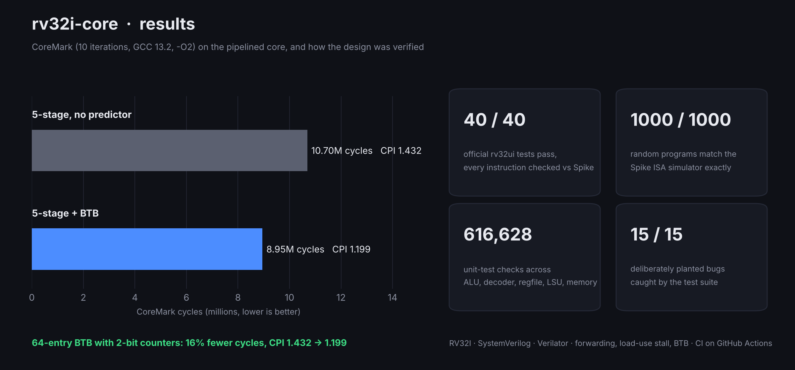
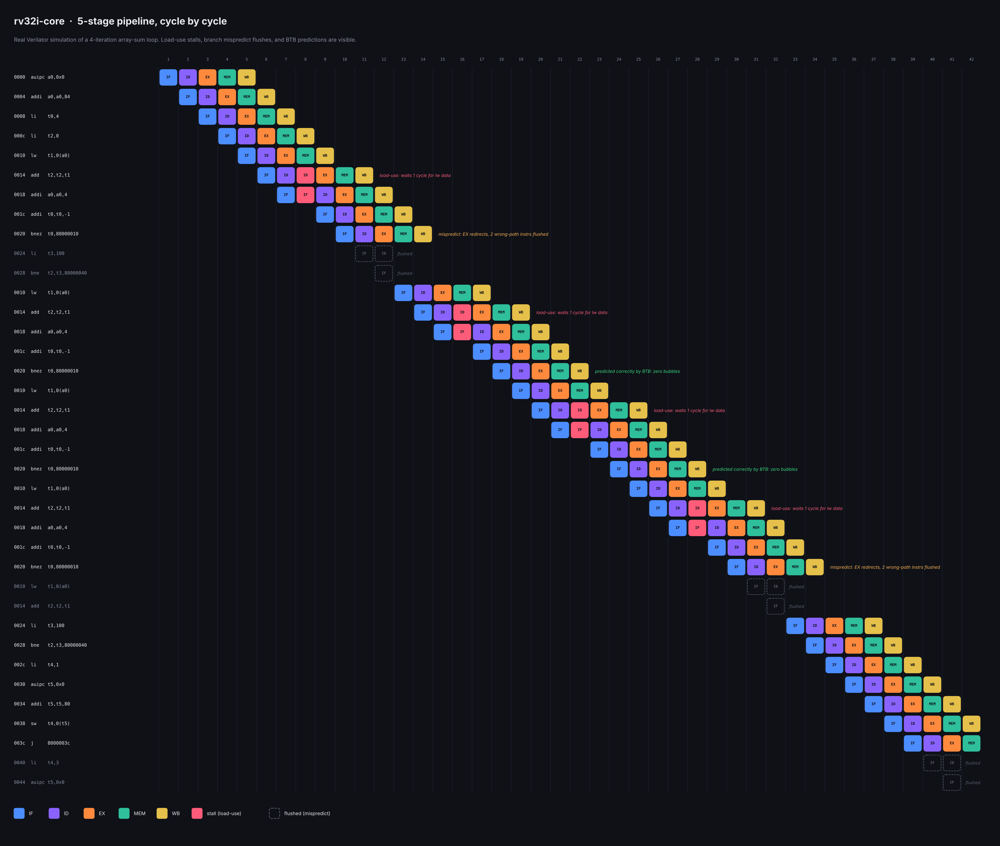
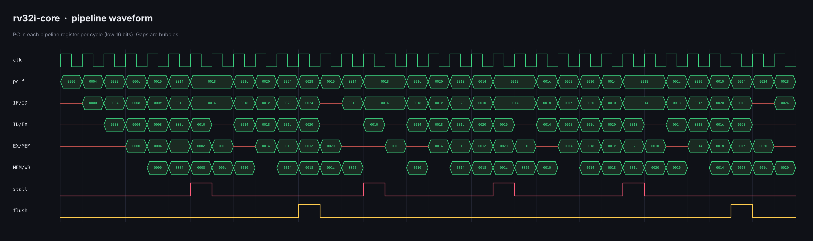

# RV32I Pipelined Core


A RISC-V (RV32I) processor in SystemVerilog, with two implementations that share one test flow:

- **Single-cycle core** (`rtl/core.sv`): every instruction completes in one clock. The simple reference.
- **5-stage pipelined core** (`rtl/core_pipe.sv`): IF, ID, EX, MEM, WB with forwarding, load-use stalls, branch resolution in EX and a 64-entry branch target buffer with 2-bit counters. It uses **synchronous memories** (data arrives one clock after the address), the way FPGA block RAM and ASIC SRAM work, so it is ready to go on hardware.

Every program run on either core is compared **instruction by instruction** against [Spike](https://github.com/riscv-software-src/riscv-isa-sim), the official RISC-V reference simulator: same PC, same instruction, same register written with the same value, same memory stores.



## Results

| | Single-cycle | Pipelined, no predictor | Pipelined + BTB |
| --- | --- | --- | --- |
| Official riscv-tests (rv32ui) | 40 / 40 | 40 / 40 | 40 / 40 |
| Random programs, trace-matched with Spike | 1000 / 1000 | 1000 / 1000 | 1000 / 1000 |
| CoreMark CPI | 1.000 | 1.432 | **1.199** |
| CoreMark iterations per MHz (simulated) | 1.34 | 0.93 | 1.12 |
| Load-use stall cycles | 0 | 204,359 | 204,358 |
| Pipeline flushes | 0 | 1,518,787 | 644,093 |

CoreMark: 10 iterations, `-O2 -march=rv32i`, GCC 13.2, cycles counted in simulation. Its CRCs match the official performance-run values. This is not an official CoreMark score (that needs a 10-second run on real hardware).

The branch target buffer removes 58% of flushes and brings CPI from 1.43 to 1.20. It is direct-mapped (indexed by PC bits), so its hit rate depends on where code lands in memory: an unrelated change to the UART print routine moved CoreMark's loops and shifted CPI from 1.188 to 1.199. A set-associative BTB would make it less sensitive. The single-cycle core has CPI 1.0, but its clock period has to fit the entire datapath; the pipeline exists to raise the clock frequency, which gets measured once the design is on an FPGA.

## Watching the pipeline

`make images` runs a small array-sum loop (`sw/demo/pipeline_demo.S`) on the pipelined core with `+pipeview`, which logs the PC in every stage each cycle, and draws it. Every box below comes from the simulation, not drawn by hand. You can see the one-cycle load-use stall on each `add`, the first `bnez` mispredicting while the BTB is cold (two wrong-path instructions flushed), the next two iterations predicted with zero bubbles, and the loop exit mispredicting.



The same run as a waveform: the PC held in each pipeline register, with bubbles as flat lines.




**Unit tests** (each module against an independently written reference model):

| Module | Checks | Method |
| --- | --- | --- |
| ALU | 101,440 | Edge cases + random, vs. a 64-bit integer model |
| Register file | 10,068 | Random writes/reads vs. a model array |
| Immediate generator | 100,022 | Real instructions + random encode/decode round trips |
| Decoder | 300,054 | Spec MASK/MATCH table: every instruction, near-miss illegal encodings, random words |
| Load/store unit | 100,033 | Byte-level model of every load and store at every offset |
| Memory | 5,011 | Program load, byte-enabled writes, out-of-range accesses |

## Pipeline

```
        IF              ID               EX                MEM            WB
   +----------+   +------------+   +--------------+   +-----------+   +--------+
   | PC, BTB  |-->| decode,    |-->| ALU, branch  |-->| load /    |-->| write  |
   | imem     |   | regfile,   |   | compare,     |   | store     |   | rd,    |
   | predict  |   | immgen     |   | next PC      |   | (LSU)     |   | retire |
   +----------+   +------------+   +--------------+   +-----------+   +--------+
        ^               |  ^             ^   ^  |            |              |
        |   load-use    |  +--- regfile bypass  |   forward  |              |
        |   stall ------+                |   +--|--- MEM ----+              |
        |                                +------|--- WB ------------------- +
        +---------- redirect + flush on a wrong guess -----+
```

- **Forwarding:** results go from EX/MEM and MEM/WB straight back to EX.
- **Load-use stall:** a load followed by an instruction that needs its result waits one cycle.
- **Memory timing:** the instruction memory is given the *next* PC, so the instruction is ready when its PC reaches IF. The data memory is given its address in EX, so load data arrives in MEM and stores are written at the end of EX. Switching to synchronous memories changed no CPI.
- **Control:** IF guesses the next PC (BTB hit and counter says taken, else PC+4). EX computes the real one; on a mismatch it redirects and flushes the two younger instructions.

## Verification

1. **Unit tests** for every module, each against a reference model written differently from the RTL, so the two can't share a bug.
2. **riscv-tests:** the official rv32ui suite, run with a minimal environment (`tests/env/riscv_test.h`) since this core has no CSRs. `fence_i` (needs Zifencei) and `ma_data` (misaligned accesses) are skipped.
3. **Differential testing:** `scripts/rv.py` generates random, always-legal RV32I programs (half of them confined to 4 registers so instructions depend on each other constantly), runs each on the core and on Spike, and compares the commit traces line by line.
4. **Mutation testing:** bugs were planted on purpose to prove the tests catch them. Every one was caught:

| Planted bug | Caught by |
| --- | --- |
| SRA without `$signed` | ALU unit test |
| Writable x0 | Register file unit test |
| Swapped B-format immediate bits; missing sign extension | Immediate generator unit test |
| `addi` decoded as `sub` when immediate bit 30 is set | Decoder unit test |
| `lb` without sign extension | LSU unit test |
| JALR not clearing bit 0 | Random programs (14 of 20 failed) |
| BLTU compared as signed | riscv-tests + random programs |
| No EX/MEM forwarding; no MEM/WB forwarding | riscv-tests + random programs |
| No load-use stall | riscv-tests + random programs |
| No register-file bypass | riscv-tests + random programs |
| No flush after a wrong guess | riscv-tests + random programs |
| Instruction memory given the current PC instead of the next one | hello.elf trace mismatch |
| PC not held during a stall | Random programs (21 of 30 failed) |

**Real bugs found during development:**

- Linking with `-Ttext` put the ELF header below 0x8000_0000, so Spike refused to load programs. Fixed with a proper linker script.
- The testbench released reset on the same clock edge it started tracing, so the first instruction was missing from the trace. Fixed by releasing reset just after a clock edge.
- Newer Verilator flagged random-test variables declared with a value inside a loop: SystemVerilog gives those their value only once. Fixed by declaring and assigning separately.

## On an FPGA (Terasic DE2-115, Cyclone IV)

`fpga/de2_115/` puts the pipelined core on a DE2-115 board running CoreMark from on-chip block RAM, at the board's 50 MHz clock. The program prints its report on the RS-232 port, and the board shows the result without any cable: green LED 8 for pass, and the CoreMark score on the 7-segment displays.

`make fpga_sim` simulates the whole board design (the same Verilog Quartus compiles) with a UART receiver in the testbench. It checks that CoreMark prints "Correct operation validated", that the PASS LED lights, and that pressing reset runs it again correctly.

Steps for the board are in [fpga/de2_115/README.md](fpga/de2_115/README.md).

## Running it

Needs Verilator 5, a RISC-V GCC (`riscv-none-elf-` by default; set `CROSS=` for another prefix), Spike, Python 3.

```
make deps        # download riscv-tests and CoreMark (once)
make test        # unit tests
make lint
make hello       # sw/hello.c on the pipelined core, compared with Spike
make isa         # rv32ui tests
make random N=1000
make coremark    # all three cores
make check       # lint + test + hello + isa + random
make fpga_sim    # the whole DE2-115 design running CoreMark (needs sv2v)
make fpga        # regenerate the DE2-115 Quartus files
make images      # README images
```

`CORE=single`, `CORE=pipe` (default) or `CORE=pipe_nobtb` picks the core.

## Layout

```
rtl/      rv_pkg (shared types), alu, regfile, immgen, decoder, lsu, mem,
          core (single-cycle), core_pipe (5-stage)
tb/       a self-checking testbench per module, and tb_core for whole programs
sw/       linker script, startup code, hello.c, CoreMark port
scripts/  rv.py: run, compare with Spike, riscv-tests, random programs
tests/    test environment for riscv-tests (suites download into here)
fpga/     DE2-115 board: top level, block RAM, UART, 7-segment, Quartus project
docs/     spec.md: design decisions
```

## Next

- FPGA: measured Fmax and resource use from Quartus, and photos of the board running.
- Zicsr and machine-mode traps, then the official architecture tests (ACT4).
- M extension (hardware multiply/divide) and a return-address stack for `jalr`.
- The same core through LibreLane on SKY130, to GDS.
